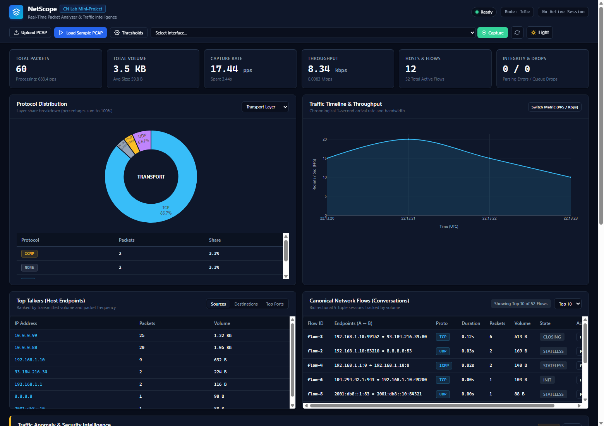
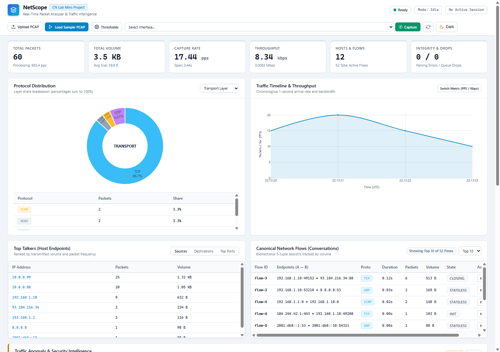

# NetScope: Real-Time Network Packet Analyzer & Traffic Intelligence Dashboard

[](https://www.python.org/)
[](https://flask.palletsprojects.com/)
[](https://scapy.net/)
[](docs/test_report.md)
[]()
[]()

> **Computer Networks Laboratory Mini-Project Deliverable (Release 2.0)**  
> An autonomous, mathematically verified network packet analyzer, statistical intelligence engine, and interactive professional web dashboard with dual Light/Dark theme support.

---

## NetScope 2.0 Interface Preview

| Dark Theme (Default Lab Mode) | Light Theme (Auditorium & Print Mode) |
|:---:|:---:|
|  |  |

| Deep Packet Layer Inspector | Explainable Security Anomaly Cards |
|:---:|:---:|
|  |  |

---

## 1. Project Overview & Highlights
NetScope ingests network packet captures (offline `.pcap` / `.pcapng` files and live network interfaces), parses multi-layer protocols, computes academically verified traffic metrics, detects stateful security anomalies (SYN floods, port scans), groups conversations into 5-tuple flows, and visualizes the results on an interactive web dashboard with zero external CDN dependencies.

### Core Features & What's New in NetScope 2.0:
- **Professional Dual-Theme System (Light & Dark)**:
  - Engineered with comprehensive semantic design tokens (`--bg-canvas`, `--surface-card`, `--text-primary`, `--border-subtle`).
  - Single-click theme switcher in header with instant transition and zero page reload.
  - Zero-flash startup using inline DOM script; automatically honors OS system preference (`prefers-color-scheme`) with persistent `localStorage`.
  - **Dynamic Plotly Relayout**: Real-time chart recoloring without re-fetching network datasets or redrawing from scratch.
- **Offline PCAP Ingestion**: Incremental, memory-bounded reading of PCAP/PCAPNG captures with stream closure guarantees and sub-millisecond parsing.
- **Deep Protocol Decoding**: Detailed multi-layer extraction across Ethernet, ARP, IPv4, IPv6, TCP, UDP, ICMP, DNS, HTTP, and TLS.
  - **Comprehensive DNS Parsing**: Decodes transaction ID, query names, query type names (`A`, `AAAA`, `CNAME`, `MX`, `TXT`, `PTR`, `NS`, `SOA`), flags (`AA`, `TC`, `RD`, `RA`), response codes (`NOERROR`, `NXDOMAIN`, `SERVFAIL`), and answer records.
- **Strict Classification**: Validates application-layer payload byte signatures (HTTP verbs, TLS record headers) rather than guessing from port numbers alone.
- **Deterministic Analytics**: Throughput (bps/kbps/Mbps), packets-per-second (PPS), average packet size, capture duration, protocol percentages, relative timing from $t_0 = 0.000\text{s}$, and chronological time buckets.
- **Canonical Flow Tracking & Consistent Counting**:
  - Symmetric 5-tuples `(IP A, IP B, Protocol, Port A, Port B)` tracking bidirectional conversations, forward/reverse volumes, inter-arrival durations, TCP connection states (`SYN_SENT`, `SYN_ACK`, `ESTABLISHED`, `RESET`, `CLOSING`, `CLOSED`), and per-flow packet filtering.
  - Dynamic flow table limit selection (10, 25, 50, All) with synchronized `Showing Top X of Y Flows` badge matching top-level KPI metrics.
- **Explainable Anomaly Alerts (Zero `undefined` Artifacts)**:
  - Heuristic detection distinguishing observable traffic facts from unconfirmed suspicions. Flags rapid SYN bursts, vertical/horizontal multi-port scans, packet rate spikes, and dominant hosts.
  - Every alert displays verified strings for **Observed Value**, **Configured Threshold**, **Sliding Time Window**, **Affected Host**, and **Target**.
  - **Interactive Packet Evidence Links**: Clickable supporting packet badges jump straight into the Protocol Layer Inspector for that exact frame.
- **Dynamic Threshold Configuration**: Runtime threshold adjustment modal and API (`GET/POST /api/alerts/config`) enabling instant tuning without restarting the server.
- **Packet Explorer**: High-performance grid with sticky table headers, sub-millisecond search, combinable protocol/IP/port/packet ID/flow ID filters, pagination, click-to-inspect detail modal, and RFC 4180 CSV export.
- **Defensive Robustness**: Gracefully handles malformed, truncated, or unhandled packets without crashing, labeling them as `Malformed` with diagnostic reasons.
- **Offline Readiness**: Self-contained frontend bundle with local Plotly.js (`plotly.min.js`), requiring no active internet connection.

---

## 2. Repository Structure

```
netscope/
│   app.py                      # Flask Application entry point
│   config.py                   # Environment configuration & limits
│   requirements.txt            # Pinned dependency manifest
│   pytest.ini                  # Pytest configuration & warning filters
│   benchmark_experiments.py    # Automated performance & correctness suite
│   README.md                   # Comprehensive documentation & setup
│   .gitignore                  # Git ignore rules
│
├── capture/                    # Packet Ingestion Subsystem
│   │   __init__.py
│   │   pcap_reader.py          # Incremental offline PCAP/PCAPNG processor
│   │   live_capture.py         # Asynchronous live sniffer thread & queue
│   │   generate_samples.py     # Deterministic sample PCAP generator
│
├── analyzer/                   # Parsing & Classification Subsystem
│   │   __init__.py
│   │   parser.py               # Normalized multi-layer packet decoder & DNS parser
│   │   protocol_classifier.py  # Payload inspection & protocol identification
│   │   flow_tracker.py         # Bidirectional 5-tuple flow & TCP state tracker
│
├── analytics/                  # Traffic Analytics & Heuristics
│   │   __init__.py
│   │   statistics.py           # Throughput, PPS, averages & time-series
│   │   anomaly_detector.py     # Configurable SYN flood, port scan & rate alert rules
│
├── storage/                    # Persistence Subsystem
│   │   __init__.py
│   │   database.py             # Parameterized SQLite session & alert storage
│
├── routes/                     # REST API Service
│   │   __init__.py
│   │   api.py                  # Endpoints for stats, packets, flows, alerts & CSV
│
├── templates/                  # Frontend Presentation
│   │   index.html              # Responsive dark navy dashboard layout
│
├── static/                     # Assets & Scripts
│   ├── css/
│   │   └── style.css           # Custom dark theme styles & filter tags
│   └── js/
│       ├── charts.js           # Plotly chart renderers
│       ├── dashboard.js        # Controller, safe DOM rendering, flows & alerts
│       └── vendor/
│           └── plotly.min.js   # Offline Plotly.js library
│
├── tests/                      # Automated Quality Assurance Suite
│   │   conftest.py             # Test client & deterministic fixtures
│   │   test_parser.py          # Protocol parsing, DNS & defensive decoding tests
│   │   test_statistics.py      # Metric calculations & formula tests
│   │   test_pcap_reader.py     # PCAP reading & error handling tests
│   │   test_anomaly_detector.py# Heuristic alerts, false-positive & config tests
│   │   test_filters.py         # Query, port, packet ID, flow ID & CSV export tests
│   │   test_api.py             # REST API endpoint integration & config tests
│   │   test_lifecycle.py       # Capture lifecycle & queue stress tests
│
├── data/                       # Captures & Datasets
│   │   README.md               # Dataset descriptions & verification notes
│   │   sample_traffic.pcap     # Deterministic 60-packet multi-protocol fixture
│
└── docs/                       # Academic Submission Documentation
    ├── problem_statement.md    # Problem statement & academic motivation
    ├── objectives_and_scope.md # Project scope, deliverables & constraints
    ├── architecture.md         # Architecture design & Mermaid topology
    ├── protocol_design.md      # Normalized schema & API contract
    ├── implementation.md       # Module-by-module technical breakdown
    ├── test_plan.md            # Verification strategy & test matrix
    ├── test_report.md          # Complete test results (41/41 passing)
    ├── performance_report.md   # Empirical benchmarks (throughput, latency, memory)
    ├── limitations.md          # Technical constraints & driver notes
    ├── demo_script.md          # Five-minute presentation walkthrough
    ├── viva_questions.md       # 28 comprehensive viva questions & answers
    ├── wireshark_verification.md# Industrial Wireshark comparison procedure
    ├── screenshot_checklist.md # Visual evidence inventory
    ├── contributions.md        # Individual team contribution record
    └── screenshots/            # Verified application captures
```

---

## 3. Installation & Setup

### Prerequisites:
- Python 3.10+ (Tested on Python 3.13.2 64-bit)
- Windows, Linux, or macOS
- *(Optional)* [Npcap](https://npcap.com/) on Windows with "WinPcap API-compatible mode" for live packet sniffing.

### Step 1: Clone or Navigate to Project
```bash
cd serene-mendeleev
```

### Step 2: Create and Activate Virtual Environment
On Windows (PowerShell):
```powershell
python -m venv .venv
.\.venv\Scripts\Activate.ps1
```
On Linux / macOS:
```bash
python3 -m venv .venv
source .venv/bin/activate
```

### Step 3: Install Pinned Dependencies
```bash
pip install -r requirements.txt
```

---

## 4. Running the Application

### Launch Flask Server:
```bash
python app.py
```
Output:
```
[*] NetScope running on http://127.0.0.1:5000
[*] Academic Computer Networks Mini-Project
[*] Ready for offline PCAP ingestion and live packet analysis.
```

### Access Dashboard:
Open your browser and navigate to:
```
http://127.0.0.1:5000
```

---

## 5. Usage Instructions

1. **Instant Sample Demonstration**:
   - Click the **Load Sample PCAP** button in the header.
   - NetScope immediately parses the bundled 60-packet multi-protocol capture.
   - Summary cards, protocol donut charts, traffic timeline, top talkers, flows, and security alerts populate in milliseconds.

2. **Upload Custom PCAP**:
   - Click **Upload PCAP** and select any `.pcap`, `.pcapng`, or `.cap` file (up to 50 MB).
   - The engine parses frames incrementally and updates all analytics.

3. **Explore and Filter Packets**:
   - Use the search bar for instant full-text filtering across IPs, ports, and protocols.
   - Filter by protocol (`TCP`, `UDP`, `ICMP`, `ARP`, `DNS`, `HTTP`, `TLS`, `IPv6`).
   - Filter by specific port (`Src Port`, `Dst Port`) or exact packet number (`Pkt #`).
   - Click any packet row to open the **Protocol Layer Inspector** modal displaying Ethernet, IP, TCP/UDP, and application fields (including DNS transaction IDs and answer records).

4. **Conversation Flow Tracking**:
   - Inspect the **Active Flows** card to review bidirectional conversations, data volumes, packet counts, and TCP states.
   - Click the **Filter Flow** button on any flow to filter the packet explorer table to only packets belonging to that conversation.
   - Click the active flow badge to clear the flow filter.

5. **Security Alerts & Threshold Tuning**:
   - Inspect security alerts detailing affected hosts, observed values, thresholds, sliding time windows, and supporting packet references.
   - Click any packet reference badge to inspect that specific packet immediately.
   - Click **Configure Thresholds** in the Alerts header to adjust SYN flood or port scan thresholds in real-time.

6. **Export Dataset**:
   - Apply any desired filters and click **Export CSV** to download the active filtered dataset with Flow ID and Relative Time columns.

7. **Live Packet Capture**:
   - Select an available network interface from the dropdown and click **Capture**.
   - If Npcap is not installed on Windows, NetScope displays clear diagnostic remediation.

---

## 6. Running Tests & Benchmarks

### Execute Test Suite:
```powershell
.\.venv\Scripts\pytest.exe -v
```
All **43 tests** pass with 100% success rate in ~2.21 seconds.

### Run Performance & Correctness Benchmarks:
```powershell
.\.venv\Scripts\python.exe benchmark_experiments.py
```
This runs Experiments A through E, testing offline processing rate, mathematical formula correctness, filter latency, API endpoint speed, and live driver capabilities.

---

## 7. Performance & Verification Highlights

| Metric | Measured Result |
|---|---|
| **Small Capture Processing (60 pkts)** | **2,750.25 PPS** (0.0218 s) |
| **Medium Capture Processing (500 pkts)** | **1,588.92 PPS** (0.3147 s) |
| **Large Capture Processing (2,500 pkts)** | **1,425.06 PPS** (1.7543 s) |
| **Formula Accuracy vs Ground Truth** | **100% exact match** across all 10 metrics |
| **Filter Query Latency** | Under **0.81 milliseconds** across all queries |
| **Dashboard API Latency** | Under **0.89 milliseconds** across all endpoints |
| **Memory Footprint** | Bounded **104.7 MB - 112.7 MB RSS** |

---

## 8. Academic Viva & Documentation Index
- [Problem Statement & Motivation](docs/problem_statement.md)
- [Architecture & Mermaid Topology](docs/architecture.md)
- [Protocol Design & API Contract](docs/protocol_design.md)
- [Implementation Details](docs/implementation.md)
- [Automated Test Report](docs/test_report.md)
- [Performance & Benchmarks Report](docs/performance_report.md)
- [Operational Limitations](docs/limitations.md)
- [5-Minute Demonstration Script](docs/demo_script.md)
- [28 Viva Voce Questions & Answers](docs/viva_questions.md)
- [Wireshark Verification Procedure](docs/wireshark_verification.md)
- [Visual Evidence & Screenshots](docs/screenshot_checklist.md)
- [Team Contribution Record](docs/contributions.md)

---

## 9. License & Academic Attribution
Developed as an autonomous Computer Networks Laboratory Mini-Project. Code is structured for educational reproducibility and local academic defense.
