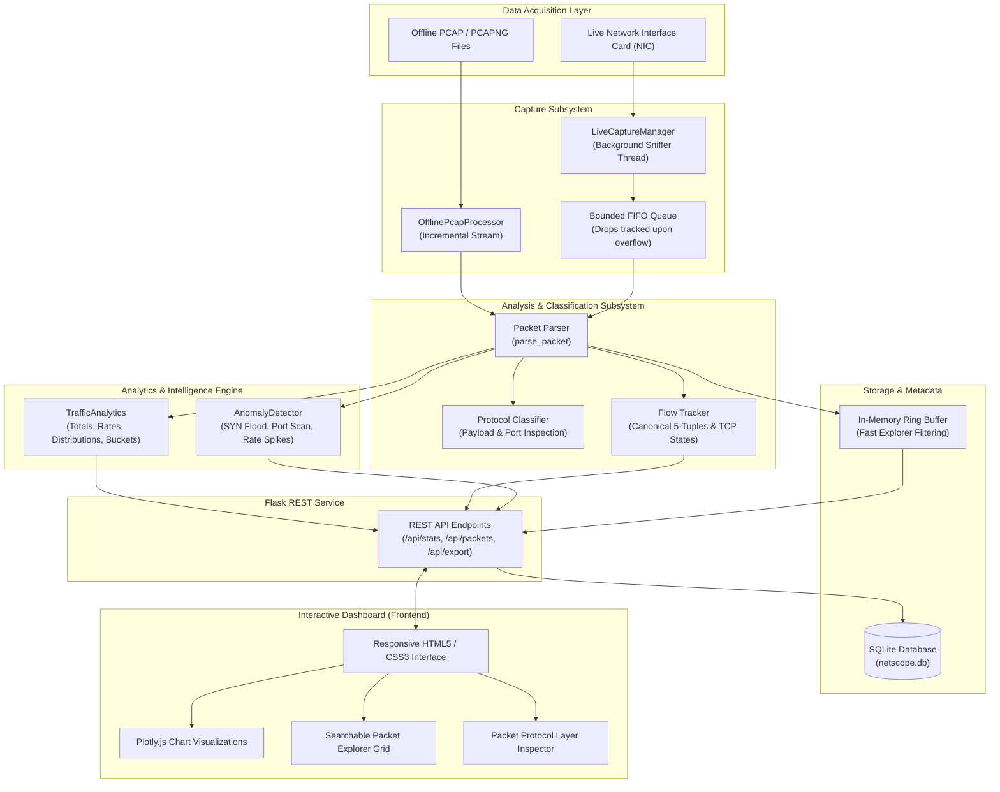

# NetScope: Architectural Design & Topology

## 1. System Overview
NetScope follows a decoupled, modular layered architecture comprising five primary subsystems:
1. **Packet Capture Subsystem** (`capture/`): Manages incremental offline PCAP reading and asynchronous live capture thread lifecycle.
2. **Analyzer & Classifier Subsystem** (`analyzer/`): Decodes binary packet frames into normalized dictionaries and tracks canonical bidirectional network flows.
3. **Analytics Engine** (`analytics/`): Computes mathematically rigorous traffic rates, protocol distributions, and evaluates explainable anomaly rules.
4. **Storage & Persistence Subsystem** (`storage/`): Manages parameterized SQLite storage for capture sessions, summaries, and alert history.
5. **Presentation Subsystem** (`routes/`, `templates/`, `static/`): Flask REST API and an asynchronous, zero-dependency HTML5/Plotly dashboard.

---

## 2. Mermaid Architecture Diagram

---

## 3. Data Flow Specification

### Offline Ingestion Pipeline:
1. User uploads a `.pcap` or `.pcapng` file via the web dashboard (`POST /api/captures/upload`) or triggers sample capture loading (`POST /api/captures/load-sample`).
2. `OfflinePcapProcessor` opens the file stream via Scapy's `PcapReader` and emits packet objects sequentially.
3. `parse_packet()` extracts link, network, transport, and application fields into a normalized dictionary.
4. `TrafficAnalytics` updates running counters (bytes, packets, protocol tallies, time buckets).
5. `FlowTracker` records canonical bidirectional flows and TCP state transitions.
6. `AnomalyDetector` evaluates sliding-window heuristics for real-time and volumetric anomalies.
7. `DatabaseManager` persists session metadata, summary JSON, and alerts in SQLite.
8. The frontend asynchronously fetches summary statistics and renders Plotly charts and packet rows.

### Live Capture Pipeline:
1. User selects a network interface and clicks **Capture**.
2. `LiveCaptureManager` initializes a producer-consumer thread pair:
   - **Sniff Producer Thread**: Uses Scapy's `sniff(prn=enqueue)` to push raw packets into a bounded queue (`queue.Queue(maxsize=5000)`). If the queue fills up, incoming packets increment `queue_drops` without freezing the capture callback.
   - **Worker Consumer Thread**: Pops packets from the queue, executes parsing and analytics ingestion, and checks for anomaly alerts.
3. Clean shutdown: When the user clicks **Stop**, a `threading.Event` is set, gracefully joining both threads with a 2-second timeout and flushing remaining items.
